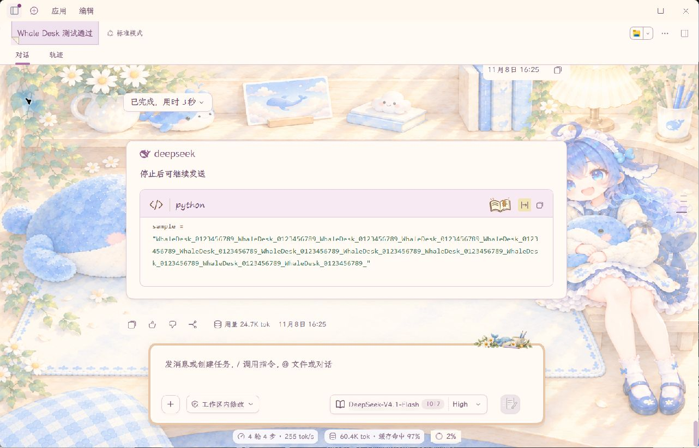
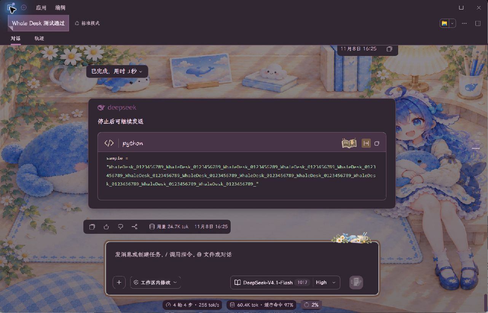
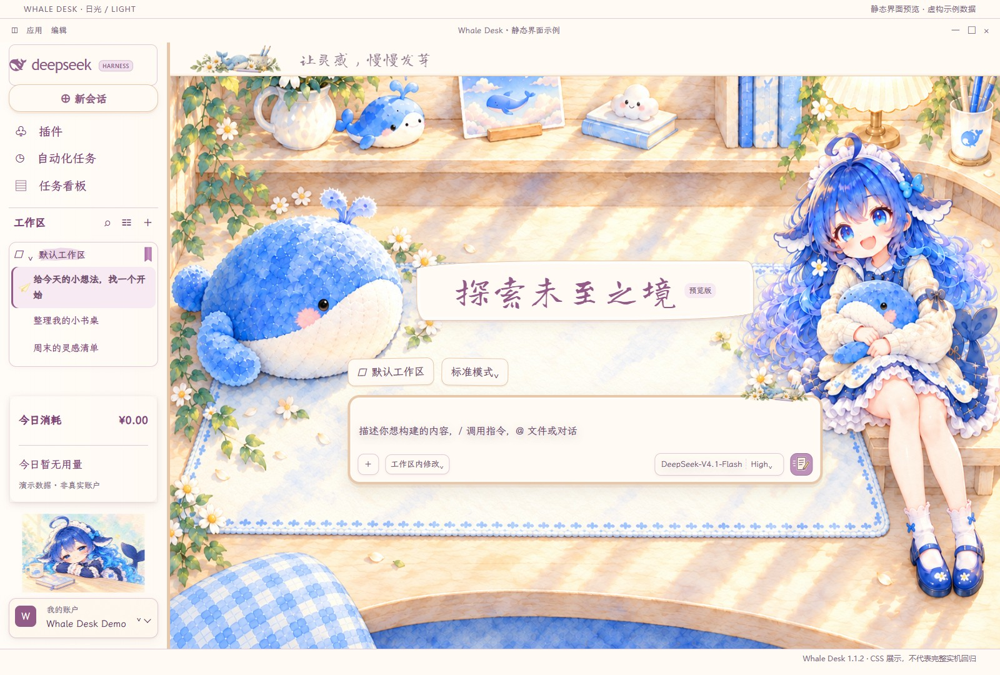
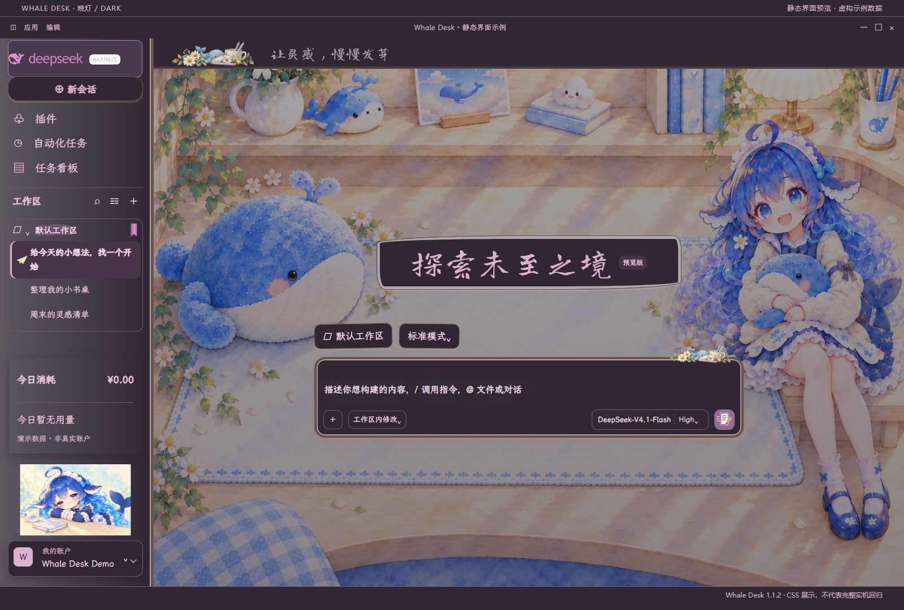

# Whale Desk

[简体中文](README.zh.md)

Created and maintained by **Xtsaixuexi**.

A nonofficial watercolor desk skin for DeepSeek Harness, derived from
[DIY Journal 1.14.1](https://github.com/Alphazerolan/diy-journal-skin).
Cream wood, mauve lettering and the community Whale-chan character keep the
native sidebar, conversation and workspace layout.

## Install and update

Skin manifest v2, version 1.1.3. Copy this whole directory to
`$DSH_HOME/skins/whale-desk` (default: `~/.dsh/skins/whale-desk`), then choose
Whale Desk in Settings > Skins. No build, Node.js or Python is needed to use it.
Back up personal edits first. After replacing an active skin's files, switch to
Official Default and then apply Whale Desk again. See the update caveat below;
this does not guarantee that the existing desktop window drops stale CSS.

Includes CSS, fonts and artwork only. No executable hooks. Pets are managed by
the separate DSH pet plugin; this package does not bundle pet animations.

## Native captures and market status

Author Xtsaixuexi states that the permissions required to use and publicly redistribute the skin, illustrations and characters in this project have been obtained. The author maintains the project and permission records and handles verification directly with the market maintainers. See [NOTICE](NOTICE). [Submission #106](https://github.com/zhu1090093659/dsh-skins/pull/106) records the separate market review status.

| Native light | Native dark |
| --- | --- |
|  |  |

Unedited 1.1.3 native captures, with the pet disabled and account/history sidebar collapsed. Current verification scope: [TESTING.md](https://github.com/Xtsaixuexi/whale-desk-skin/blob/e15e22beb85c4b1d06b3badcb058f99f1b9ecced/skins/whale-desk/TESTING.md).

## Preview and validation

These previews use the shipped CSS and fictional data; they are not native DSH
screenshots. Native smoke checks used Windows, DSH 0.2.1-rc.2 and Skin Center
0.4.8. The companion repository records tested cases and remaining limits:
[testing report](https://github.com/Xtsaixuexi/whale-desk-skin/blob/e15e22beb85c4b1d06b3badcb058f99f1b9ecced/skins/whale-desk/TESTING.md).
CSS regression also covers the 0.4.8 and 0.4.16 safety transformations.

## Customize and credits

The companion source repository (public) contains
an offline editor, JSON configuration tools, a full manual and a component gallery.
Maintainers must sync `DESK-OVERRIDES.css` into `patches.css` after editing it.

Project code: [LICENSE](LICENSE). Artwork: [LICENSE-ARTWORK](LICENSE-ARTWORK).
Sources, character creators and font licenses: [NOTICE](NOTICE).
Per-image provenance and hashes: [ARTWORK.json](ARTWORK.json).
Illustrations are for personal, non-commercial use. Permission matters are handled by the author as stated in NOTICE.
This is not an official DeepSeek theme or an Android/iOS app theme.

Update caveat: Skin Center 0.4.8 may retain old styles at the same path in an existing desktop window. Reapplying is not guaranteed to clear them. Reopen DSH after running tasks finish; original-path cold restart was tested successfully. If theme selection reverts, finish active tasks and restart normally; this is a recovery step, not a proven root-cause fix.

## 来源与授权状态 / Source and permission record

| 内容 / Content | 来源 / Source | 状态 / Status |
| --- | --- | --- |
| DIY Journal 1.14.1 皮肤与配图 | [Alphazerolan](https://github.com/Alphazerolan/diy-journal-skin) | 作者确认团队使用授权 / author-confirmed team permission |
| 原角色及女仆改造 | 上善 / ZipZipPipe，见 [NOTICE](NOTICE) 所列公开署名 | 作者声明相关使用与再分发授权已取得 / author-declared use and redistribution permission |
| Whale Desk 适配、新书桌与花饰 | Xtsaixuexi / OpenAI image generation | 项目自身贡献；不替代第三方角色许可 / project contribution does not grant third-party rights |

本项目由 Xtsaixuexi 持续维护；授权记录、版权与来源事项由作者负责，并与维护者直接对接。This is the author's declaration; market review remains a separate maintainer decision. See NOTICE.
