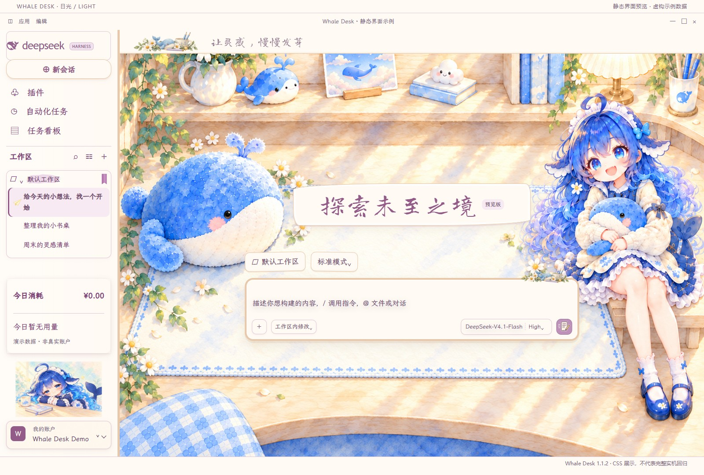
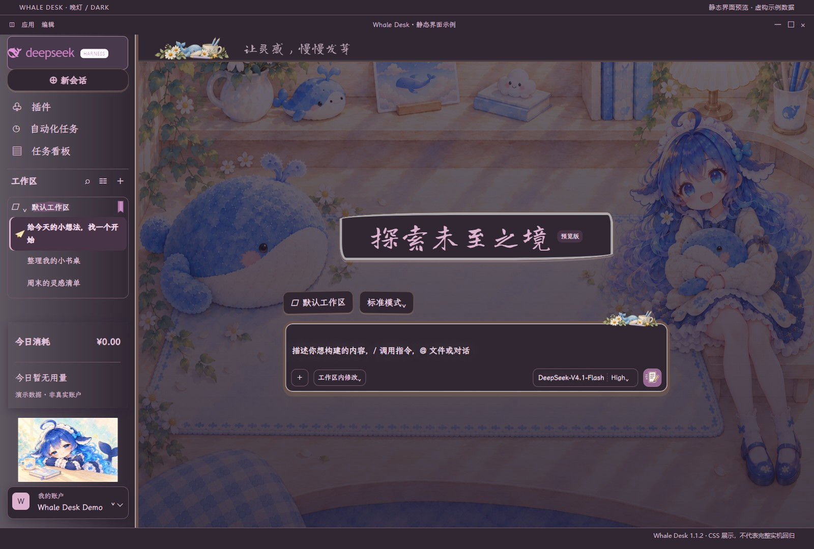

# Whale Desk

[简体中文](README.zh.md)

Created and maintained by **Xtsaixuexi**.

A nonofficial watercolor desk skin for DeepSeek Harness, derived from
[DIY Journal 1.14.1](https://github.com/Alphazerolan/diy-journal-skin).
Cream wood, mauve lettering and the community Whale-chan character keep the
native sidebar, conversation and workspace layout.

## Install and update

Skin manifest v2, version 1.1.2. Copy this whole directory to
`$DSH_HOME/skins/whale-desk` (default: `~/.dsh/skins/whale-desk`), then choose
Whale Desk in Settings > Skins. No build, Node.js or Python is needed to use it.
Back up personal edits first. After replacing an active skin's files, switch to
Official Default and then apply Whale Desk again. See the update caveat below;
this does not guarantee that the existing desktop window drops stale CSS.

Includes CSS, fonts and artwork only. No executable hooks. Pets are managed by
the separate DSH pet plugin; this package does not bundle pet animations.

## Native captures and market status

[Submission #106](https://github.com/zhu1090093659/dsh-skins/pull/106) is awaiting maintainer CI approval and review; it has not been merged or listed. Status checked 2026-11-08.

| Native light | Native dark |
| --- | --- |
|  |  |

These Windows DSH captures use the original skin ID, with account sidebar hidden. They are separate from the static catalog previews below. The pet is a separate plugin. Light selection once reverted to dark; a user restart restored operation and a subsequent light/dark/light round trip persisted for the observed interval. Its root cause remains unknown; see [TESTING.md](TESTING.md).

## Preview and validation

These previews use the shipped CSS and fictional data; they are not native DSH
screenshots. Native smoke checks used Windows, DSH 0.2.1-rc.2 and Skin Center
0.4.8. The companion repository records tested cases and remaining limits:
[testing report](TESTING.md).
CSS regression also covers the 0.4.8 and 0.4.16 safety transformations.

## Customize and credits

The companion source repository (currently private) contains
an offline editor, JSON configuration tools, a full manual and a component gallery.
Maintainers must sync `DESK-OVERRIDES.css` into `patches.css` after editing it.

Project code: [LICENSE](LICENSE). Artwork: [LICENSE-ARTWORK](LICENSE-ARTWORK).
Sources, character creators and font licenses: [NOTICE](NOTICE).
Per-image provenance and hashes: [ARTWORK.json](ARTWORK.json).
Illustrations are for personal, non-commercial use. Character redistribution
clearance remains independently unverified and is disclosed for market review.
This is not an official DeepSeek theme or an Android/iOS app theme.

Update caveat: Skin Center 0.4.8 may retain old styles at the same path in an existing desktop window. Reapplying is not guaranteed to clear them. Reopen DSH after running tasks finish; original-path cold restart was tested successfully. If theme selection reverts, finish active tasks and restart normally; this is a recovery step, not a proven root-cause fix.
